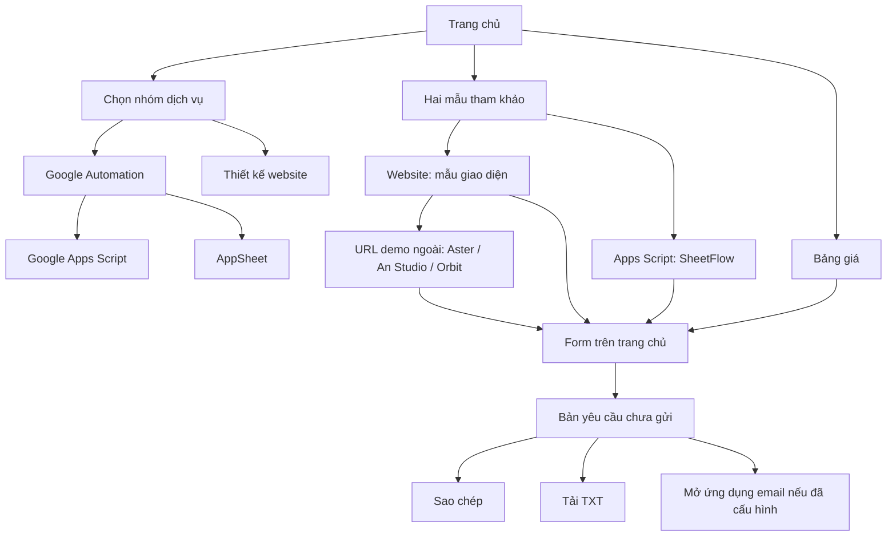

# WebSheet — Đặc tả thiết kế và kế hoạch chuyển sang Nuxt / Vue 3

> Bản chụp thiết kế: 29/10/2026. Nguồn đối chiếu là mã nguồn trong workspace tại thời điểm viết, bao gồm các thay đổi chưa commit; không khẳng định đây là bản đã deploy.
>
> Mục tiêu: đủ thông tin để dựng lại giao diện và hành vi hiện tại bằng Nuxt/Vue 3, giữ đường dẫn trang và luồng chọn dịch vụ, đồng thời chuyển nhận diện sang WebSheet. Tài liệu này chưa thực hiện migration.
>
> Quyết định thương hiệu: **WebSheet**, tên miền **websheet.shop** đã được người dùng xác nhận mua. Cấu hình DNS, HTTPS và triển khai trên tên miền mới chưa được xác nhận. Source hiện vẫn mang tên CoreBrisk. Tài liệu hiện dùng tên `NUXT_VUE3_DESIGN.md`.

**Mục lục**

- [1. Cách sử dụng tài liệu](#1-cách-sử-dụng-tài-liệu)
- [2. Định vị sản phẩm và giới hạn phạm vi](#2-định-vị-sản-phẩm-và-giới-hạn-phạm-vi)
- [3. Kiến trúc và build hiện tại](#3-kiến-trúc-và-build-hiện-tại)
- [4. Sơ đồ route và điều hướng](#4-sơ-đồ-route-và-điều-hướng)
- [5. Design system](#5-design-system)
- [6. Thiết kế trang chủ](#6-thiết-kế-trang-chủ)
- [7. Bảng giá và phạm vi dịch vụ](#7-bảng-giá-và-phạm-vi-dịch-vụ)
- [8. Thiết kế các trang dịch vụ](#8-thiết-kế-các-trang-dịch-vụ)
- [9. Preview và demo](#9-preview-và-demo)
- [10. Form và hợp đồng tương tác](#10-form-và-hợp-đồng-tương-tác)
- [11. SEO, nhận diện và indexability](#11-seo-nhận-diện-và-indexability)
- [12. Tài nguyên và hiệu năng](#12-tài-nguyên-và-hiệu-năng)
- [13. Kiến trúc Nuxt / Vue 3 đề xuất](#13-kiến-trúc-nuxt--vue-3-đề-xuất)
- [14. Tương tác Vue và các điểm dễ sai khi migration](#14-tương-tác-vue-và-các-điểm-dễ-sai-khi-migration)
- [15. SEO và cấu hình Nuxt đề xuất](#15-seo-và-cấu-hình-nuxt-đề-xuất)
- [16. Cloudflare và pipeline đích](#16-cloudflare-và-pipeline-đích)
- [17. Accessibility và progressive enhancement](#17-accessibility-và-progressive-enhancement)
- [18. Kiểm thử và tiêu chí nghiệm thu](#18-kiểm-thử-và-tiêu-chí-nghiệm-thu)
- [19. Lộ trình thực hiện đề xuất](#19-lộ-trình-thực-hiện-đề-xuất)
- [20. Điểm đã quyết định và điểm chưa chốt](#20-điểm-đã-quyết-định-và-điểm-chưa-chốt)
- [21. Tham chiếu kỹ thuật](#21-tham-chiếu-kỹ-thuật)
- [22. Phụ lục: metadata của sáu trang public](#22-phụ-lục-metadata-của-sáu-trang-public)
- [23. Phụ lục: nội dung FAQ](#23-phụ-lục-nội-dung-faq)

## 1. Cách sử dụng tài liệu

Hướng dẫn cấu trúc, quy tắc code, màu sắc, font và style dành cho AI: [AI_CODING_GUIDE.md](AI_CODING_GUIDE.md).

- Các mục **hiện trạng / phải giữ** mô tả sản phẩm đã có và các quyết định đã thống nhất. Riêng tên WebSheet và domain mới là yêu cầu đích đã chốt, chưa được áp dụng vào mã nguồn/triển khai.
- Các mục **đề xuất Nuxt** là phương án triển khai mới, chưa phải cấu hình đang chạy.
- Khi cần đối chiếu kích thước, màu sắc hoặc câu chữ nguyên bản, dùng các file nguồn được liên kết trong từng mục.
- Nội dung cũ trong README có thể còn mô tả số gói hoặc CTA trước đây. Các yêu cầu dưới đây lấy theo HTML/CSS/JS hiện tại.
- Không dùng nội dung trong `dist/` làm nguồn thiết kế: đây là đầu ra của lần build gần nhất, có thể khác môi trường Cloudflare.

Các nguồn chính:

| Phạm vi                             | Nguồn hiện tại                                             |
| ----------------------------------- | ---------------------------------------------------------- |
| Trang chủ và form                   | [index.html](index.html)                                   |
| Tương tác trang chủ                 | [src/main.js](src/main.js)                                 |
| CSS entry và thứ tự cascade         | [src/style.css](src/style.css)                             |
| Trang dịch vụ                       | [dich-vu/](dich-vu/) và [src/service.css](src/service.css) |
| Metadata, schema, sitemap, robots   | [src/seo.mjs](src/seo.mjs)                                 |
| Build, chèn metadata, đóng gói demo | [vite.config.js](vite.config.js), [scripts/](scripts/)     |
| Hosting                             | [wrangler.jsonc](wrangler.jsonc)                           |
| Biến public                         | [.env.example](.env.example)                               |
| Kiểm thử                            | [tests/](tests/)                                           |

## 2. Định vị sản phẩm và giới hạn phạm vi

WebSheet là website giới thiệu dịch vụ thiết kế website và tự động hóa công việc bằng Google Sheets, Apps Script, AppSheet. Trang chủ đóng vai trò landing page tổng hợp; có thêm năm trang dịch vụ và các demo minh họa.

### 2.1. Hai nhóm dịch vụ

1. **Google Automation**: tự động hóa bảng tính, tổng hợp dữ liệu, báo cáo, ứng dụng nhập liệu/quản lý bằng Apps Script hoặc AppSheet.
2. **Website & Web App**: landing page, website doanh nghiệp, ứng dụng web theo yêu cầu.

Google Automation đứng trước Website trong nhóm dịch vụ và bảng giá.

### 2.2. Quy tắc kinh doanh phải giữ

- Apps Script từ **0,9 triệu VNĐ/dự án** và AppSheet từ **7,9 triệu VNĐ/dự án** là chi phí **thiết kế và triển khai theo yêu cầu riêng**.
- Giá này bao gồm phạm vi khảo sát, xây dựng, kiểm thử, bàn giao được nêu trên từng gói; chi phí cuối cùng phụ thuộc yêu cầu đã thống nhất.
- Demo Sheets không phải sản phẩm làm sẵn đang được bán với mức giá đó.
- Mẫu làm sẵn có giá thấp hơn; bảng giá và phạm vi sử dụng sẽ công bố riêng theo từng sản phẩm. Chưa có mức giá cụ thể để đưa vào ứng dụng.
- “Tiện ích Google Sheets” là nhóm giải pháp, không phải gói thứ ba tính tiền riêng. Không phục hồi gói `sheets-extension` 3,9 triệu từng xuất hiện trong mô tả cũ.
- Ba website Aster S5, An Studio, Orbit là concept minh họa; không giới thiệu là dự án khách hàng thật.
- Các gói Business/Custom nói tới phạm vi dịch vụ có thể xây cho khách, không có nghĩa website WebSheet hiện đã có CMS, backend hay tài khoản người dùng.

### 2.3. Chưa thuộc phạm vi migration

- Danh mục sản phẩm số, bộ lọc sản phẩm, trang bán template.
- Giỏ hàng, thanh toán, giao file, license, lịch sử đơn hàng.
- Đăng nhập, dashboard khách hàng, CMS hoặc cơ sở dữ liệu.
- Endpoint nhận yêu cầu tư vấn, gửi mail tự động, thông báo cho nhân viên.
- Chuyển mã nguồn ba demo sang Vue hoặc mang mã demo vào project Nuxt mới. Demo được build/deploy riêng; việc dọn repo Vite cũ thực hiện riêng khi cần.

Đây là các hướng mở rộng đã được trao đổi, chưa được triển khai. Migration cần giữ website dịch vụ hoạt động trước.

### 2.4. Thương hiệu và tên miền đã chốt

| Hạng mục                 | Quyết định                                                                                    |
| ------------------------ | --------------------------------------------------------------------------------------------- |
| Tên thương hiệu hiển thị | **WebSheet**; viết thống nhất với W và S hoa                                                  |
| Tên miền đã mua          | `websheet.shop` — theo xác nhận của người dùng                                                |
| DNS / HTTPS / triển khai | Chưa xác nhận; cần kiểm tra trước khi chuyển traffic                                          |
| URL production đích      | `https://websheet.shop/` (không `www`), chỉ kích hoạt sau khi cấu hình và kiểm tra thành công |
| Mô tả thương hiệu        | **Thiết kế website & Google Sheets theo yêu cầu.**                                            |
| Trạng thái hiện tại      | Website tĩnh giới thiệu dịch vụ; chưa có API bán hàng, giỏ hàng hoặc thanh toán               |
| Hướng mở rộng            | Bán mẫu website/Sheets và sản phẩm số trong giai đoạn sau; chưa đưa vào phạm vi hiện tại      |

Đuôi `.shop` là lựa chọn tên miền, không thay đổi nghiệp vụ hiện tại thành cửa hàng trực tuyến. Bảng giá vẫn là giá thiết kế riêng; demo vẫn là mẫu tham khảo. Không dùng CTA “Mua ngay” hoặc mô tả đang bán template khi chưa triển khai chức năng đó.

Khi thực hiện đổi thương hiệu, đồng bộ header/footer, nội dung dịch vụ/FAQ, tiêu đề bản yêu cầu tư vấn, metadata, schema và hình ảnh nhận diện. Tên kỹ thuật hiện có như package `corebrisk-business-landing` và biến demo `COREBRISK_URL` được giữ trong mô tả hiện trạng; việc đổi các tên này cần cập nhật đồng bộ script và cấu hình khi triển khai.

## 3. Kiến trúc và build hiện tại

### 3.1. Công nghệ

- HTML/CSS/JavaScript thuần, Vite multi-page application.
- Package: `corebrisk-business-landing`, ESM (`type: module`).
- Manifest hiện dùng Vite `^8.2.2`, Wrangler `^4.154.0`.
- Node theo manifest: `^20.19.0 || >=22.12.0`; các demo khai báo `>=22.12.0`.
- Không có Vue, Nuxt, router frontend hay UI framework trong code hiện tại.
- Sáu trang public có HTML nội dung ngay từ build; trang dịch vụ không cần JavaScript riêng để đọc nội dung, mở FAQ và theo link.

### 3.2. Pipeline

```text
HTML nguồn + CSS + src/main.js + SITE_URL + URL demo
  → Vite: sáu HTML entry
  → thay SEO_HEAD / placeholder demo
  → phát robots.txt / sitemap.xml khi đủ cấu hình
  → đóng gói ba demo + public assets
  → dist/
  → Cloudflare Workers Static Assets
```

- `static-seo.transformIndexHtml` chèn HTML từ `seoHead()`.
- `pageForPath()` nhận route dạng thư mục, `index.html` hoặc URL có query và tìm metadata tương ứng.
- `generateBundle()` sinh robots/sitemap; sitemap không do Cloudflare tự suy ra từ nội dung website.
- Cloudflare có thể chạy build, vì vậy file sinh trên hosting không bắt buộc trùng bản `dist/` local.
- `wrangler.jsonc`: worker `business-landing`, compatibility date `2026-10-28`, assets directory `./dist`, chưa có Worker xử lý nghiệp vụ.
- Không thay bằng SPA fallback trả homepage cho mọi đường dẫn không tồn tại.

### 3.3. Lệnh đang có

| Lệnh                      | Chức năng                                      |
| ------------------------- | ---------------------------------------------- |
| `npm run dev`             | Vite tại `127.0.0.1:5174`                      |
| `npm run build`           | Tạo `dist/`                                    |
| `npm run preview`         | Phục vụ build tại `127.0.0.1:4174`             |
| `npm test`                | Kiểm thử SEO và hai build trong thư mục tạm    |
| `npm run test:browser`    | Build rồi chạy Chrome kiểm thử ở cổng 4187     |
| `npm run generate:social` | Tạo ảnh social card bằng Chrome                |
| `npm run generate:icons`  | Rasterize biểu tượng SVG thành PNG bằng Chrome |

Không cần Chrome trên máy build Cloudflare nếu các ảnh sinh sẵn được đưa vào repository.

## 4. Sơ đồ route và điều hướng

### 4.1. Sáu route public phải giữ

| URL chuẩn                          | Mục đích                               | Lựa chọn form khi mở tư vấn |
| ---------------------------------- | -------------------------------------- | --------------------------- |
| `/`                                | Trang chủ, mẫu rút gọn, bảng giá, form | `unsure` mặc định           |
| `/dich-vu/google-automation/`      | Chọn giải pháp Google Automation       | `automation`                |
| `/dich-vu/google-apps-script/`     | Dịch vụ Apps Script, SheetFlow         | `apps-script`               |
| `/dich-vu/appsheet/`               | Dịch vụ AppSheet                       | `appsheet`                  |
| `/dich-vu/tien-ich-google-sheets/` | Giải thích nhóm tiện ích Sheets        | `automation`                |
| `/dich-vu/thiet-ke-website/`       | Website, ba gói, thư viện demo         | `launch`                    |

### 4.2. Anchor và URL tương thích

| Trang                            | Anchor/URL cần giữ                                                 |
| -------------------------------- | ------------------------------------------------------------------ |
| Trang chủ                        | `#noi-dung`, `#dich-vu`, `#dich-vu-google`, `#dich-vu-website`     |
| Trang chủ                        | `#giao-dien`, `#bang-gia`, `#bang-gia-google`, `#bang-gia-website` |
| Trang chủ                        | `#quy-trinh`, `#cau-hoi`, `#lien-he`, `#quote-form`                |
| Các trang dịch vụ                | `#noi-dung`, `#giai-phap`, `#pham-vi`, `#giai-dap`, `#tu-van`      |
| Apps Script / AppSheet / Website | `#trien-khai`                                                      |
| Website và Apps Script           | `#mau-giao-dien`                                                   |
| Website                          | `#goi-launch`, `#goi-business`, `#goi-custom`                      |
| Tư vấn từ dịch vụ                | `/?plan=<plan>#lien-he`                                            |
| Tư vấn từ thẻ mẫu dịch vụ        | `/?concept=<concept>&plan=<plan>#quote-form`                       |
| Tư vấn từ demo ngoài             | `<landing-origin>/?concept=<concept>#lien-he`                      |
| Link quay về từ demo ngoài       | `<landing-origin>/#giao-dien`                                      |

Với link từ demo ngoài, `<landing-origin>` là URL tuyệt đối của landing; production đích là `https://websheet.shop` sau khi cấu hình hoạt động.

Các anchor phụ cho `aria-labelledby`, form label và tiêu đề bảng vẫn cần giữ đúng quan hệ; không chỉ giữ anchor trên menu.



## 5. Design system

### 5.1. Định hướng hình ảnh

Giao diện sáng, nền trắng ngà, xanh lá dịu, typography thoáng. Bố cục chia section rõ; sử dụng viền mảnh, bo góc nhỏ, nền nhấn vừa phải. Không đổi sang dark theme, gradient rực hoặc bộ UI kit khác khi chỉ migration framework.

Nhận diện đích: **WebSheet**, mô tả **Thiết kế website & Google Sheets theo yêu cầu.** Giữ bảng màu, font và bố cục hiện tại làm nền cho lần chuyển đổi.

Nhận diện nguồn CoreBrisk hiện dùng dòng phụ **DIGITAL STUDIO**, chữ `c` cách điệu và mũi tên ↗ ở header, dấu C xanh trên nền tối ở favicon. Các biểu tượng này cần thay bằng nhận diện WebSheet trước khi ra mắt thương hiệu mới. Chưa chốt hình dạng logo mới; không coi bộ icon chữ C là logo WebSheet đã hoàn thành.

### 5.2. Token màu

Nguồn: [base.css](src/styles/base.css).

| Token                     | Giá trị   | Vai trò                          |
| ------------------------- | --------- | -------------------------------- |
| Màu chữ mặc định          | `#34443c` | Body                             |
| `--ink`                   | `#293e33` | Heading, chữ đậm                 |
| `--muted`                 | `#657469` | Mô tả, thông tin phụ             |
| `--lime`                  | `#dcebcf` | Nền nút sáng, brand mark         |
| `--accent`                | `#527449` | CTA đậm, link, nhấn              |
| `--line`                  | `#e2e9df` | Border, phân cách                |
| `--paper`                 | `#fdfefb` | Nền trang                        |
| `--surface`               | `#f3f7ef` | Nền section/thẻ nhẹ              |
| Focus ring                | `#648f25` | Outline 3px, offset mặc định 5px |
| Nền bảng giá              | `#f7f9f3` | Pricing                          |
| Nền liên hệ               | `#edf5e6` | Contact                          |
| Nền Business được đề xuất | `#edf5e5` | Cột giá Website                  |
| Nền preview Sheets        | `#eaf2e6` | SheetFlow                        |

Các màu minh họa riêng của Aster, An Studio, Orbit nằm trong `showcase.css` và `demo-previews.css`; giữ nguyên.

### 5.3. Typography

- Font `Be Vietnam Pro`, fallback `sans-serif`.
- Font local WOFF2, weights 400/500/600/700; mỗi weight có latin, latin-ext, vietnamese.
- `font-display: swap`, `font-synthesis: none`; không gọi Google Fonts từ trình duyệt.
- Body desktop 14px/1.7, mobile 13px.
- H2 chung: `clamp(30px, 3.1vw, 44px)`, weight 400, tracking -1.8px, line-height 1.25.
- H3 chung weight 500; các section có override riêng.
- Eyebrow mặc định 10px, tracking 1.7px, weight 500, khoảng dưới 22px.
- H1 hero và tiêu đề trang dịch vụ có stylesheet riêng; giữ thứ tự CSS để không bị scale sai.
- Nội dung bảng tính trong preview là chi tiết minh họa thu nhỏ; mô tả chính và CTA phải đọc được ở kích thước thông thường.

### 5.4. Bố cục và responsive

| Mốc                 | Quy tắc chính                                                         |
| ------------------- | --------------------------------------------------------------------- |
| Mặc định            | Container `min(1180px, calc(100% - 96px))`; section padding dọc 104px |
| `min-width: 1450px` | Hero có khoảng đệm và chiều cao visual rộng hơn                       |
| `max-width: 1100px` | Container `calc(100% - 64px)`, giảm gap/size hero                     |
| `max-width: 850px`  | Hero, nhóm dịch vụ, contact chuyển dọc; section 74px                  |
| `max-width: 600px`  | Container `calc(100% - 40px)`, menu mobile, thẻ mẫu trang chủ một cột |
| `max-width: 360px`  | Container `calc(100% - 32px)`, thu nhỏ mockup                         |

- Hai thẻ mẫu trang chủ: hai cột trên desktop/tablet trên 600px; một cột ở mobile; preview cao 300px.
- Thư viện website: ba cột trên 1100px, hai cột ở trung gian, một cột mobile.
- SheetFlow đầy đủ: preview và mô tả hai cột; dưới 850px xếp dọc.
- Bảng giá website: ba cột, bảng min-width 624px ở màn nhỏ và cuộn trong `.comparison-scroll`.
- Không còn cột `.comparison-label` hoặc cột tiêu chí cố định. Tên tiêu chí nằm trong từng ô.
- Không được gây cuộn ngang toàn trang tại 320px.
- Bộ viewport đối chiếu: 1440, 1024, 768, 600, 390, 320px.

### 5.5. Button, card và trạng thái

- `.button`: inline-flex, gap 28px, padding 14px 22px, radius 4px, font 13px.
- `.button-dark`: nền accent, chữ trắng; `.button-outline`: nền trong, viền nhạt.
- `.text-link`: liên kết phụ với mũi tên, hover gạch chân.
- CTA hero mobile toàn chiều ngang, cao tối thiểu 52px; link thao tác chính có vùng bấm tối thiểu 44px.
- Card thường radius 5–8px, preview SheetFlow đầy đủ radius 12px ở khung ngoài.
- Focus hiển thị rõ; không dùng màu làm tín hiệu duy nhất cho trạng thái SheetFlow.
- `prefers-reduced-motion: reduce`: tắt animation/transition và smooth scroll.
- Hover nút nâng 1px, transition 0.2s; không thêm carousel/autoplay cho mẫu.

### 5.6. Thứ tự CSS phải bảo toàn ban đầu

`fonts → base → header → hero → services → showcase → pricing → process → faq → contact → footer → dialog → responsive/desktop → responsive/tablet → responsive/mobile → responsive/compact → reduced-motion → demo-previews`.

Trang dịch vụ nạp thêm `service.css` sau stylesheet chung. Trong Nuxt cần scope quy tắc trang dịch vụ bằng wrapper `.service-detail` hoặc cách tổ chức tương đương, tránh CSS của route đã ghé làm thay đổi trang chủ.

## 6. Thiết kế trang chủ

### 6.1. Header

- Sticky top, z-index 10, nền trắng ngà có blur, border dưới.
- Nav desktop: **Dịch vụ · Giao diện · Bảng giá · Quy trình · Liên hệ**.
- Brand bấm về đầu trang; skip link đến `#noi-dung`.
- Mobile có nút menu 44×44; `aria-expanded`, `aria-controls`, nhãn Mở/Đóng menu.
- Đóng menu khi chọn link, click ngoài, nhấn Escape hoặc viewport trở lại desktop; Escape trả focus về nút menu.
- Gạch chân mục đang xem bằng `aria-current="location"`; cuộn trang không cập nhật history/hash liên tục.
- Tính section hiện hành dựa trên đáy header +24px, hỗ trợ section cuối khi ở cuối trang.

### 6.2. Hero

- Eyebrow: `WEBSITE · GOOGLE SHEETS · APPSHEET`.
- H1: **Thiết kế website. / Tự động hóa / công việc.**
- Mô tả: website, landing page, web app; Google Sheets, Apps Script, AppSheet.
- CTA chính **Trao đổi dự án** → `#quote-form`.
- CTA phụ **Xem dự án mẫu** → `#giao-dien`.
- Dòng nhỏ **Tư vấn ban đầu miễn phí.** xuất hiện ở đây; không khôi phục nhiều nút “tư vấn miễn phí”.
- Hai dấu kiểm: thiết kế theo nhu cầu; bàn giao và hướng dẫn.
- Visual: mockup kiến trúc desktop + điện thoại dựng bằng HTML/CSS, vòng trang trí, nhãn thiết bị, badge kỹ thuật.
- Mockup có mô tả cho trình đọc màn hình; các hình/biểu tượng thuần trang trí được ẩn khỏi cây accessibility.
- Dải dưới hero giới thiệu Apps Script, AppSheet, tiện ích Sheets và thiết kế website.

### 6.3. `01 / CHỌN NHÓM DỊCH VỤ`

- Hai thẻ: Google Automation và Website & Web App.
- Mỗi thẻ có icon SVG, nhãn lĩnh vực, tên, mô tả ngắn, một link **Khám phá dịch vụ**.
- Link lần lượt đến `/dich-vu/google-automation/` và `/dich-vu/thiet-ke-website/`.
- Không đặt lại hai nút tư vấn trong các thẻ này.

### 6.4. `02 / MẪU THAM KHẢO`

- H2 **Một số mẫu tham khảo.**
- Chỉ hai thẻ đại diện, không hiển thị toàn bộ thư viện trên trang chủ.
- Thẻ Website dùng ảnh Aster S5; caption **Website & web app**, mô tả mẫu landing page ô tô.
- Thẻ Sheets dùng minh họa SheetFlow thu gọn; caption **Tiện ích Google Sheets**, ghi rõ giao diện minh họa theo yêu cầu.
- Cả vùng preview và link **Xem mẫu** dẫn tới `#mau-giao-dien` trên trang dịch vụ tương ứng, cùng tab.
- Không đặt giá mua template, nút mua hàng hoặc iframe Sheets trực tiếp tại đây.
- Ghi chú chung: mẫu minh họa giao diện, phạm vi triển khai thống nhất theo nhu cầu.

### 6.5. `03 / BẢNG GIÁ THAM KHẢO`

- H2 **Chọn gói theo nhu cầu.**; giá khởi điểm, báo giá chính thức sau trao đổi.
- Hai liên kết nội bộ: Google Automation và Website & web app.
- Phần Google có thông báo trước các thẻ: **Chi phí thiết kế riêng cho quy trình của bạn**.
- Thông báo giải thích thiết kế riêng, demo tham khảo, sản phẩm làm sẵn rẻ hơn và có bảng giá riêng về sau.
- Hai thẻ Apps Script/AppSheet; CTA **Trao đổi yêu cầu** chọn sẵn dịch vụ và đến form.
- Phần Website giữ ba cột Launch/Business/Custom; Business có nhãn **ĐỀ XUẤT** và nền nhấn.
- CTA Website **Chọn gói này**, accessible name có tên gói.
- Có năm `details.plan-details`: hai của Google, ba của Website. Mặc định đóng; mở độc lập, không ép chỉ một mục mở.
- Không thay bằng bảng sản phẩm mua ngay, giỏ hàng hay checkout.

### 6.6. `04 / CÁCH CHÚNG TÔI LÀM VIỆC`

Bốn bước theo thứ tự:

1. Khảo sát & tư vấn — chốt mục tiêu, phạm vi, ngân sách, tiến độ.
2. Thiết kế & thống nhất — duyệt giao diện hoặc quy trình.
3. Lập trình & kiểm thử — kiểm tra tính năng, kết quả cùng khách.
4. Triển khai & bàn giao — nghiệm thu, bàn giao, hướng dẫn.

### 6.7. `05 / GIẢI ĐÁP THẮC MẮC`

Bố cục hai cột: tiêu đề/mô tả/link **Trao đổi thêm** và danh sách FAQ. Dùng `details/summary` native; mục đầu mở mặc định, các mục còn lại đóng.

Sáu câu hỏi: Apps Script là gì; AppSheet là gì; tiện ích Sheets và extension; chuẩn bị để tư vấn; chi phí ngoài giá triển khai; hỗ trợ sau bàn giao. Nội dung đầy đủ vẫn nằm trong HTML và được chụp ở phụ lục cuối tài liệu.

### 6.8. Liên hệ và footer

- `#lien-he`: nền xanh nhạt, hai cột copy và form trắng.
- Tiêu đề **Mô tả dự án và tính năng bạn cần.**; gợi ý khách có thể chỉ nêu lĩnh vực và công việc cần giải quyết.
- Form `#quote-form` có `tabindex="-1"`, tiêu đề **Thông tin dự án**.
- Nút **Tạo yêu cầu tư vấn**; trạng thái xuất HTML ban đầu disabled, bật sau khi tương tác được khởi tạo.
- Footer có brand, mô tả, link Dịch vụ/Bảng giá/FAQ, về đầu trang, năm bản quyền.
- Không đặt email, số điện thoại hoặc địa chỉ chưa được cung cấp.

## 7. Bảng giá và phạm vi dịch vụ

### 7.1. Google Sheets / Apps Script / AppSheet

| Thuộc tính                 | Apps Script                                         | AppSheet                                                   |
| -------------------------- | --------------------------------------------------- | ---------------------------------------------------------- |
| Loại dịch vụ               | Lập trình theo yêu cầu                              | Ứng dụng theo yêu cầu                                      |
| Giá khởi điểm              | 0,9 triệu VNĐ/dự án                                 | 7,9 triệu VNĐ/dự án                                        |
| Phạm vi cơ bản             | 01 quy trình, tối đa 2 file Sheets                  | 01 app, tối đa 5 bảng dữ liệu và 5 màn hình                |
| Công việc                  | Làm sạch, đối soát, tổng hợp theo quy tắc           | Nhập liệu, danh sách, báo cáo                              |
| Chạy/phân quyền            | Theo lịch hoặc nút bấm; ghi nhận kết quả/lỗi cơ bản | Tối đa 2 vai trò, 01 luồng thông báo hoặc phê duyệt cơ bản |
| Tiến độ tham khảo          | 3–5 ngày làm việc                                   | 7–12 ngày làm việc                                         |
| Bàn giao                   | Mã nguồn, cấu hình, hướng dẫn                       | Cấu hình, hướng dẫn quản trị                               |
| Bảo hành lỗi trong phạm vi | 1 tháng                                             | 1 tháng                                                    |

Chưa gồm bản quyền AppSheet/Google Workspace, API, dịch vụ bên thứ ba và thuế nếu áp dụng. Tiến độ tính từ khi chốt yêu cầu và nhận đủ dữ liệu mẫu. Yêu cầu ngoài phạm vi báo giá riêng.

Giữ đoạn phân biệt mẫu sẵn ngay cạnh bảng giá, trên trang dịch vụ và trong FAQ; không chỉ giấu trong ghi chú nhỏ ở footer.

### 7.2. Website

| Thuộc tính | Launch                            | Business             | Custom                         |
| ---------- | --------------------------------- | -------------------- | ------------------------------ |
| Giá từ     | 6,9 triệu                         | 14,9 triệu           | 29,9 triệu                     |
| Loại       | Một trang                         | Website doanh nghiệp | Website/web app theo nghiệp vụ |
| Quy mô     | 01 landing page, tối đa 8 section | Tối đa 10 trang      | Theo phạm vi                   |
| Quản trị   | Trang tĩnh, CMS báo riêng         | CMS & blog           | Theo yêu cầu                   |
| Tiến độ    | 5–7 ngày làm việc                 | 15–20 ngày làm việc  | Theo phạm vi dự án             |
| Bảo hành   | 3 tháng                           | 6 tháng              | Theo hợp đồng                  |
| Demo       | Aster S5                          | An Studio            | Orbit                          |

- Launch: nhận diện, responsive, SEO cơ bản, form/Zalo/hotline theo phạm vi, mã nguồn và hướng dẫn.
- Business: hạng mục Launch, CMS, blog, đo lường theo yêu cầu, hướng dẫn quản trị.
- Custom: khảo sát nghiệp vụ, UI/UX, tài khoản/phân quyền, tích hợp API/CRM theo thỏa thuận, kiến trúc nâng cấp, tài liệu/bàn giao.
- Chưa gồm domain, hosting, nội dung, bản quyền bên thứ ba và thuế nếu áp dụng.
- Không đổi giá trong quá trình migration. Dữ liệu cần dùng chung để card, form, metadata và trang dịch vụ không lệch nhau.

## 8. Thiết kế các trang dịch vụ

Nguồn: từng `dich-vu/<slug>/index.html` và `src/service.css`.

### 8.1. Layout chung

Header riêng `.detail-header` (hiện không sticky), brand về `/`, nav Dịch vụ/Bảng giá/Liên hệ. Có breadcrumb và một H1. Hero hai cột: giới thiệu + panel giá/phạm vi. Sau đó là các section phù hợp, FAQ, CTA cuối, dịch vụ liên quan, footer tối giản.

CTA Liên hệ/Trao đổi nhu cầu/Tạo yêu cầu tư vấn dẫn về trang chủ với query `plan` và hash `#lien-he`. Header đánh dấu Dịch vụ hiện hành.

### 8.2. Google Automation

- H1: **Chọn giải pháp. Bớt việc thủ công.**
- Giới thiệu nhóm tiện ích Sheets và panel gợi ý mô tả đầu vào/đầu ra.
- Hai thẻ lựa chọn Apps Script và AppSheet, giá thiết kế theo yêu cầu cùng phạm vi/tiến độ.
- Phạm vi: xác định dữ liệu, quy tắc, số file/màn hình/người dùng, kiểm thử, bàn giao.
- FAQ phân biệt hai giải pháp, extension và kết hợp; có câu hỏi giá thiết kế riêng hay mẫu sẵn.
- Không có thư viện demo đầy đủ và không có gói tiện ích Sheets thứ ba.

### 8.3. Google Apps Script

- H1: **Lập trình Google Apps Script. Bớt việc lặp lại mỗi ngày.**
- Panel **CHI PHÍ THIẾT KẾ THEO YÊU CẦU**, từ 0,9 triệu.
- Hero có **Xem mẫu giao diện** tới `#mau-giao-dien`.
- SheetFlow đầy đủ đặt sau hero, trước phần giải thích giải pháp.
- Ba tình huống: tổng hợp báo cáo, đối soát dữ liệu, nhắc việc theo lịch.
- Quy trình: mô tả đầu vào/đầu ra → kiểm thử dữ liệu mẫu → bàn giao/hướng dẫn.
- FAQ: chạy khi tắt máy, giới hạn dữ liệu, chuẩn bị báo giá, thiết kế riêng so với mẫu sẵn.

### 8.4. AppSheet

- H1: **Thiết kế ứng dụng AppSheet. Đưa quy trình vào một ứng dụng.**
- Panel chi phí thiết kế theo yêu cầu từ 7,9 triệu, không gộp phí license định kỳ.
- Các tình huống: quản lý đơn hàng, nhập xuất kho, điều phối công việc.
- Quy trình: chuẩn hóa dữ liệu → thử theo vai trò → chuyển giao quản trị.
- Không tự tạo thêm demo AppSheet hoặc chuyển SheetFlow thành demo app đã hoạt động.

### 8.5. Tiện ích Google Sheets

- H1: **Tiện ích Google Sheets. Apps Script & AppSheet.**
- Trang giải thích nhóm dịch vụ, menu/thanh bên/công cụ bảng tính và cách chọn giải pháp.
- Hai link sang Apps Script/AppSheet; CTA nhóm dùng `plan=automation`.
- Không có mức giá “tiện ích” độc lập, không coi extension trình duyệt và tiện ích Sheets là cùng một dịch vụ mặc định.

### 8.6. Thiết kế website

- H1: **Thiết kế website doanh nghiệp. Rõ nội dung, đúng nhu cầu.**
- Panel chi phí từ 6,9 triệu, hero có link **Xem mẫu giao diện**.
- `#mau-giao-dien`: đầy đủ thẻ Aster S5, An Studio, Orbit. Mỗi thẻ có Chọn mẫu này; chỉ hiện Xem demo khi đã cấu hình URL ngoài hợp lệ.
- Demo mở tab mới; Chọn mẫu này mở lại form trang chủ trong cùng tab với concept/plan.
- Ba thẻ gói ở `#goi-launch`, `#goi-business`, `#goi-custom`; tiếp theo phạm vi, quy trình, FAQ, CTA.
- Giữ ghi chú CMS/backend/tích hợp theo phạm vi thỏa thuận và demo không phải dự án khách hàng thật.

## 9. Preview và demo

### 9.1. SheetFlow

- Preview HTML/CSS, chưa gọi Sheets API và không dùng iframe bảng tính thật.
- Full preview: thanh tên file, menu minh họa, toolbar, formula `=SUM(C5:C8)`, ba ô tổng quan, bảng đơn hàng, các tab giả lập.
- Số liệu minh họa: doanh thu 24,8 triệu; 32 đơn; 24/32 hoàn tất; bốn dòng ví dụ 6,9/8,5/4,2/5,2 triệu.
- Có nhãn giao diện/số liệu minh họa; preview là một hình minh họa có mô tả accessibility, các chi tiết trang trí `aria-hidden`.
- `SHEETS_DEMO_URL` trống: hiển thị văn bản **Demo đang chuẩn bị**, không có link giả hoặc nút bị vô hiệu hóa giả dạng link.
- Có URL HTTPS hợp lệ: hiện **Xem demo Sheets**, tab mới, `noopener noreferrer`.
- CTA **Trao đổi từ mẫu này** → `/?concept=sheetflow&plan=apps-script#quote-form`.
- Ghi rõ SheetFlow chỉ phục vụ trao đổi yêu cầu; giá 0,9 triệu là thiết kế riêng.

### 9.2. Hiện trạng ba website demo trong repo Vite cũ

Các đường dẫn dưới đây là hiện trạng của hệ thống cũ, không phải route phải dựng trong Nuxt. Chức năng bên trong demo thuộc project demo riêng.

| Demo      | Nguồn hiện tại          | Đường dẫn cũ        | Chức năng của demo riêng                                              |
| --------- | ----------------------- | ------------------- | --------------------------------------------------------------------- |
| Aster S5  | `demos/aster/site/`     | `/demos/aster/`     | Phiên bản/màu xe, ảnh đồng bộ, form báo giá/lái thử, dialog, copy/TXT |
| An Studio | `demos/an-studio/site/` | `/demos/an-studio/` | Bộ lọc nhà ở/nội thất, dialog công trình, menu, nội dung khi tắt JS   |
| Orbit     | `demos/orbit/site/`     | `/demos/orbit/`     | Tổng quan, board/list, tìm kiếm/lọc, tạo/sửa task, dự án/thành viên   |

- Aster: Standard 649 triệu, Premium 749 triệu là giá xe giả định trong demo; không liên quan bảng giá WebSheet. Trắng ngọc/Xám graphite thay ảnh. Form tạo phiếu local, không gửi đi.
- An Studio: ba concept công trình; các nội dung ảnh không đại diện dự án thật đã thực hiện. Khi tắt JS, phần mô tả công trình vẫn đọc được.
- Orbit: dữ liệu mẫu trong bộ nhớ phiên; refresh đặt lại, không đăng nhập/API/realtime. `/demos/orbit/app.html` giữ tương thích với app chính; `/presentation.html` giữ trang giới thiệu cũ, không phải entry của nút Xem demo.
- Aster/Orbit có `noindex, nofollow`; An Studio có `noindex, follow`. Không đưa các demo vào sitemap của WebSheet.
- Link quay về trang chủ `/#giao-dien` vẫn hợp lệ dù thư viện đầy đủ đã chuyển vào dịch vụ.
- Các demo có scripts build/serve riêng; Node thuần, font/tài nguyên local.
- Dev/preview riêng: An Studio 5175/4175, Orbit 5176/4176, Aster 5177/4177; WebSheet 5174/4174.

### 9.3. Quyết định đích: chỉ nhận URL demo ngoài

Hiện trạng Vite: các plugin **vẫn emit toàn bộ demo ngay cả khi đã điền URL demo bên ngoài**. Hệ thống Nuxt mới loại bỏ cơ chế này; chỉ đổi biến môi trường trong project cũ không đủ để ngừng đóng kèm.

Quyết định đã chốt: **demo website được quản lý, build và deploy độc lập; landing Nuxt chỉ lưu metadata, preview và URL để mở demo**.

- Không đưa `demos/`, plugin phục vụ demo, `siteFiles()` hay script copy/build demo vào project Nuxt. Không sinh `public/demos/` hoặc `.output/public/demos/`.
- Không tải HTML/JS của demo về đóng gói, không proxy hoặc nhúng toàn bộ demo bằng iframe. Ảnh preview tối ưu và mockup HTML/CSS của thẻ mẫu vẫn là tài nguyên UI của landing.
- Aster, An Studio, Orbit nhận URL từ `NUXT_PUBLIC_ASTER_DEMO_URL`, `NUXT_PUBLIC_AN_STUDIO_DEMO_URL`, `NUXT_PUBLIC_ORBIT_DEMO_URL`. SheetFlow tiếp tục nhận `NUXT_PUBLIC_SHEETS_DEMO_URL` khi có demo.
- Chỉ nhận URL HTTPS tuyệt đối, không chứa username/password. URL cấu hình sai làm fail build với tên biến cần sửa; không tự chuyển thành link local hoặc link giả.
- URL để trống: giữ preview, mô tả và CTA chọn mẫu/tư vấn; thay CTA Xem demo bằng văn bản **Demo đang chuẩn bị**. Không fallback về `/demos/.../` và không dùng `href="#"`.
- URL hợp lệ: Xem demo mở tab mới với `rel="noopener noreferrer"` và nhãn thông báo mở tab mới. Chọn mẫu này vẫn dẫn đến form của landing, không phụ thuộc demo có hoạt động hay không.
- Build landing không gọi build demo và không cần truy cập host demo. Kiểm tra URL đúng định dạng tại build; kiểm tra demo còn truy cập được là công việc vận hành riêng, không chặn CI của landing khi host demo tạm lỗi.

Các project demo tự quản lý dependencies, build, deploy và test. Link quay về cần là URL tuyệt đối của landing (production đích `https://websheet.shop/`); nếu giữ script cũ thì cấu hình `COREBRISK_URL` trong project demo riêng. Không đặt biến này thành cấu hình bắt buộc của Nuxt.

Với URL cũ `/demos/.../` đã được chia sẻ, lập ánh xạ redirect sang URL demo ngoài tương ứng khi có URL đích; cấu hình ở lớp hosting/redirect, không build lại demo để giữ route. Chưa có URL đích thì không tạo redirect giả hoặc chuyển về homepage; URL không được hỗ trợ trả 404. Kiểm tra riêng entry cũ của Orbit `/demos/orbit/app.html` nếu còn sử dụng.

## 10. Form và hợp đồng tương tác

### 10.1. Trường dữ liệu

| Field / id | Kiểu                            | Bắt buộc            | Giới hạn / mặc định                   |
| ---------- | ------------------------------- | ------------------- | ------------------------------------- |
| `name`     | text, autocomplete name         | Có                  | Trim, ít nhất 1 ký tự, maxlength 100  |
| `company`  | text, autocomplete organization | Không               | maxlength 150                         |
| `email`    | email, autocomplete email       | Có                  | Native validation, maxlength 150      |
| `plan`     | select                          | Có giá trị mặc định | `unsure`; chỉ dùng allowlist bên dưới |
| `budget`   | select                          | Có giá trị mặc định | `Chưa xác định`                       |
| `message`  | textarea                        | Có                  | Trim, 10–3000 ký tự                   |

Ngân sách: Chưa xác định; Dưới 10 triệu; 10–20 triệu; 20–50 triệu; Trên 50 triệu.

### 10.2. Plan và concept

| `plan`        | Nhãn hiện tại                                    |
| ------------- | ------------------------------------------------ |
| `unsure`      | Cần tư vấn thêm                                  |
| `automation`  | Tiện ích Sheets · Apps Script & AppSheet         |
| `website`     | Website · Cần tư vấn chọn gói                    |
| `launch`      | Launch · từ 6,9 triệu                            |
| `business`    | Business · từ 14,9 triệu                         |
| `custom`      | Custom · từ 29,9 triệu                           |
| `apps-script` | Google Apps Script · từ 0,9 triệu · Theo yêu cầu |
| `appsheet`    | AppSheet · từ 7,9 triệu · Theo yêu cầu           |

| `concept`   | Plan tương ứng | Tên đưa vào mô tả                               |
| ----------- | -------------- | ----------------------------------------------- |
| `aster`     | `launch`       | Aster S5 — Landing page ô tô                    |
| `an-studio` | `business`     | An Studio — Kiến trúc & nội thất                |
| `orbit`     | `custom`       | Orbit — Công nghệ & SaaS                        |
| `sheetflow` | `apps-script`  | SheetFlow — Quản lý đơn hàng trên Google Sheets |

Quy tắc hiện tại:

1. `plan` hợp lệ trong query được áp dụng trước. Giá trị không hợp lệ giữ mặc định trên một lần tải mới.
2. `concept` hợp lệ áp dụng tiếp và có quyền ưu tiên plan tương ứng nếu query xung đột.
3. Bổ sung câu `Tôi quan tâm đến hướng thiết kế <tên mẫu>.` vào message, không lặp câu đã có; giữ phần mô tả trước đó trong cùng trang, giới hạn tổng 3000 ký tự.
4. Click CTA giá chỉ đổi plan; CTA hero giữ lựa chọn và dữ liệu hiện có.
5. Bản hiện tại tải lại trang khi đi qua trang dịch vụ: dữ liệu tự gõ không được lưu qua full reload. Nuxt có thể giữ draft trong bộ nhớ qua client navigation như cải thiện riêng, nhưng không tự thêm localStorage/persistence.
6. Không đưa name/email/message vào query string hoặc payload prerender.

### 10.3. Tạo bản yêu cầu

- Native validation và trim trước khi tạo.
- Lỗi name: `Vui lòng nhập tên của bạn.`
- Lỗi message: `Vui lòng mô tả dự án ít nhất 10 ký tự.`
- Xóa custom validity khi người dùng sửa trường tương ứng.
- Nội dung gồm tiêu đề WebSheet, họ tên, doanh nghiệp (hoặc Chưa cung cấp), email, nhãn gói, ngân sách, mô tả, lời đề nghị tư vấn.
- Xuất text vào textarea readonly, không dùng HTML từ dữ liệu nhập.
- Không gọi API hoặc gửi email khi submit; không ghi database/localStorage.

### 10.4. Dialog và các trạng thái

- Native `<dialog id="quote-dialog">`, `showModal()` khi form hợp lệ.
- Tiêu đề **Bản yêu cầu tư vấn**, thông báo rõ **chưa được gửi**.
- Đóng bằng nút ×, Escape, click backdrop ngoài bounding box; khóa cuộn body khi mở, bảo toàn focus.
- Copy thành công: thông báo có thể dán vào email/ứng dụng nhắn tin.
- Copy lỗi: focus/select textarea, hướng dẫn Ctrl+C/⌘C hoặc tải file.
- TXT: `yeu-cau-tu-van-du-an.txt`, UTF-8 BOM để giữ tiếng Việt; tạo Blob URL và revoke sau khi tải.
- Email: chỉ hiện khi email liên hệ cấu hình hợp lệ; dùng `mailto:` với subject/body encode. Người dùng tự xác nhận gửi trong ứng dụng email.
- `#copy-status`: `role="status"`, `aria-live="polite"`.
- Tắt JS: đọc được trang/FAQ/giá; nút submit disabled, có hướng dẫn bật JS. Không cho native form vô tình gửi thông tin qua URL.

## 11. SEO, nhận diện và indexability

### 11.1. Metadata

Nguồn duy nhất hiện tại: `src/seo.mjs` (vẫn mang thương hiệu CoreBrisk). Các giá trị WebSheet dưới đây là đặc tả SEO đích; không tạo thêm block tên site ghi cứng trong template.

- `lang="vi"`, UTF-8, viewport, theme color `#fdfefb`.
- Một title, description riêng cho mỗi route; một H1.
- Open Graph: type website, locale `vi_VN`, site_name **WebSheet**, title/description tương ứng.
- Twitter card `summary_large_image`, title/description và ảnh cùng origin chuẩn.
- Canonical/og:url lấy origin cấu hình + route chuẩn có dấu `/` cuối, không chứa query/hash.
- Social image: `/social-card.png`, 1200×630, alt mô tả WebSheet.
- Giữ thông tin xác minh Search Console hiện có trong quá trình chuyển đổi; xác minh riêng property tên miền đã mua khi cấu hình SEO production. Không giả định token hiện tại đã xác minh `websheet.shop`, không thay bằng token ví dụ.
- Favicon PNG 192×192, Apple touch icon 180×180, logo tổ chức 512×512.
- Head khi chuyển route bằng Vue phải cập nhật và dọn metadata cũ, không để nhiều canonical hoặc WebSite.

### 11.2. Structured data

| Trang                 | Schema                                         |
| --------------------- | ---------------------------------------------- |
| Trang chủ             | `ProfessionalService`                          |
| Trang chủ có site URL | Thêm đúng một `WebSite`                        |
| Dịch vụ               | `Service`                                      |
| Dịch vụ có site URL   | Thêm `BreadcrumbList`: Trang chủ → tên dịch vụ |

- Business: `@id=<siteUrl>#business`, name WebSheet, url, logo ImageObject 512×512, areaServed Việt Nam, knowsAbout các dịch vụ.
- Website: `@id=<siteUrl>#website`, name WebSheet, alternateName `websheet.shop` khi tên miền này được hiển thị nhất quán trên website, url canonical trang chủ, inLanguage vi-VN, publisher tham chiếu business.
- Service provider tham chiếu `#business`; service URL đúng route.
- Serialize JSON an toàn; thay ký tự `<` bằng `\u003c` trong JSON trước khi đưa vào script, không chèn dữ liệu người dùng.
- Không tạo Product/Offer/Review/AggregateRating cho demo; chưa có sản phẩm số bán lẻ hoặc đánh giá thực để khai báo.

### 11.3. Hai chế độ build

| Điều kiện              | Kết quả                                                                                                     |
| ---------------------- | ----------------------------------------------------------------------------------------------------------- |
| Không có site URL      | `noindex, follow`; không canonical, og:url, ảnh absolute, sitemap; robots vẫn Allow để crawler thấy noindex |
| Có site URL hợp lệ     | `index, follow, max-image-preview:large`; canonical/OG/schema URL và sitemap đồng bộ                        |
| Site URL sai định dạng | Fail build; không tự sửa thành hostname giả                                                                 |

Site URL chỉ chấp nhận HTTPS tại root, không username/password, subpath, query hoặc hash. Chuẩn hóa thành origin có dấu `/` cuối.

`robots.txt` public: `User-agent: *`, `Allow: /`, thêm dòng `Sitemap: <siteUrl>sitemap.xml` khi có cấu hình. Sitemap chỉ có sáu URL trong mục 4; không có demo, query chọn gói, preview hoặc route sản phẩm chưa tồn tại.

Tên website và favicon trên Google do Google lựa chọn sau khi crawl. Khi đổi thương hiệu cần đồng bộ tín hiệu WebSheet, không hứa đổi SERP ngay. Hướng dẫn đối chiếu: [Google Site names](https://developers.google.com/search/docs/appearance/site-names), [Google favicon](https://developers.google.com/search/docs/appearance/favicon-in-search).

### 11.4. SEO cho thương hiệu WebSheet và domain mới

- Tên site mong muốn: **WebSheet**. Đồng bộ `WebSite.name`, `ProfessionalService.name`, `Service.provider.name`, `og:site_name`, header/footer và nội dung hiển thị. Tên site là thương hiệu; title từng trang mô tả dịch vụ cụ thể. [Hướng dẫn tên site của Google](https://developers.google.com/search/docs/appearance/site-names).
- Title đích của sáu trang nằm ở mục 22, dùng hậu tố `| WebSheet` đúng một lần. Không giữ CoreBrisk trong metadata production mới.
- Sau khi domain hoạt động, canonical trang chủ là `https://websheet.shop/`; mỗi trang dịch vụ giữ nguyên path. Ví dụ: `https://websheet.shop/dich-vu/google-apps-script/`.
- Cùng dùng origin mới cho `og:url`, ảnh chia sẻ, logo schema, `#business`, `#website`, breadcrumb và sáu URL sitemap. Robots trỏ tới `https://websheet.shop/sitemap.xml`.
- Đổi nội dung hình favicon/logo/social card cùng với tên thương hiệu, không chỉ thay alt hoặc filename. Các kích thước ảnh và đường dẫn public ở mục 12 có thể giữ.
- SEO hiện tập trung vào nhu cầu thuê thiết kế/lập trình theo yêu cầu. Trang nhóm Google Automation giúp chọn giải pháp; các trang Apps Script, AppSheet, tiện ích Sheets và website giải thích phạm vi tương ứng. Không mô tả là kho template đang bán hoặc khai báo schema thương mại cho sản phẩm chưa có.
- Đây là định hướng cấu trúc/nội dung và SEO kỹ thuật; chưa phải kết quả nghiên cứu lượng tìm kiếm, lịch biên tập hay cam kết thứ hạng.

### 11.5. Điều kiện kích hoạt domain và chuyển URL

1. **Đã mua `websheet.shop`** theo xác nhận của người dùng. Bước tiếp theo: cấu hình/kiểm tra DNS, custom domain Cloudflare và HTTPS; xác minh từng trang/asset hoạt động trước khi chuyển traffic.
2. Khi sẵn sàng public, đặt `SITE_URL=https://websheet.shop/` với Vite hoặc `NUXT_PUBLIC_SITE_URL=https://websheet.shop/` với Nuxt rồi build/deploy lại. Chỉ đổi URL production sau khi domain mới được cấu hình và kiểm tra hoạt động. Bản public cũ giữ URL đang hoạt động; bản preview dùng chính sách noindex đã nêu ở mục 11.3.
3. Lập ánh xạ URL cũ → URL mới cùng đường dẫn. Với hostname cũ đang public và còn kiểm soát, cấu hình chuyển hướng vĩnh viễn 301/308 sang trang tương ứng; không dồn mọi URL về trang chủ. Giữ query chọn gói/mẫu hoạt động và kiểm tra các link có hash từ demo. Nếu phục vụ biến thể `www`, chuyển hướng về bản không `www`.
4. Xác minh property mới trong Search Console, gửi sitemap mới; cân nhắc công cụ Change of Address nếu property cũ đủ điều kiện. Theo dõi index, lỗi crawl và redirect trên cả hai host. Không chặn crawler bằng robots trên host cũ khiến không đọc được redirect.
5. Tách lần chuyển domain và lần đổi framework thành các mốc kiểm chứng riêng khi có thể; giữ phương án rollback. Chọn thời điểm chuyển sau khi xác minh domain mới sẵn sàng phục vụ.

Việc mua tên miền đã hoàn tất theo xác nhận của người dùng; các bước cấu hình, SEO và chuyển traffic trong checklist chưa được xác nhận thực hiện. Tham chiếu: [Google — chuyển website sang URL mới](https://developers.google.com/search/docs/crawling-indexing/site-move-with-url-changes).

## 12. Tài nguyên và hiệu năng

| Tài nguyên                       | Mục đích                                                            |
| -------------------------------- | ------------------------------------------------------------------- |
| `public/favicon.svg`             | Nguồn vector hiện là chữ C của CoreBrisk; cần cập nhật cho WebSheet |
| `public/favicon.png`             | Favicon 192×192                                                     |
| `public/apple-touch-icon.png`    | Apple icon 180×180                                                  |
| `public/logo.png`                | Logo schema 512×512                                                 |
| `public/social-card.png`         | OG/Twitter 1200×630                                                 |
| `public/aster-preview-480.webp`  | Preview responsive nhỏ                                              |
| `public/aster-preview-960.webp`  | Preview responsive lớn                                              |
| `public/fonts/`                  | Be Vietnam Pro, 12 WOFF2 và OFL.txt                                 |
| `demos/*/site/assets/` (repo cũ) | Thuộc các project demo riêng; không copy toàn bộ vào Nuxt           |

- Giữ URL public ổn định; không cần đổi favicon URL ở mỗi build.
- Aster preview có `srcset`, `sizes`, width/height, lazy loading, decoding async. Không dùng ảnh PNG xe gần 2MB làm preview trên landing.
- Mockup hero, An Studio, Orbit, SheetFlow thu gọn được dựng bằng HTML/CSS; không bắt buộc chuyển thành bitmap.
- Giữ giấy phép font và nguồn ảnh cho tài nguyên preview được dùng trong landing. Tài nguyên/giấy phép riêng của demo đi cùng project demo.
- Landing chỉ dựng preview; không hydrate demo, tải app Orbit hoặc import tài nguyên từ source demo trong build. Demo chạy ở deployment độc lập.
- Không preload toàn bộ font/ảnh; chỉ cân nhắc sau đo thực tế.
- Chưa có ngân sách Lighthouse/Core Web Vitals đã được cam kết. So sánh trước/sau trên cùng môi trường, tránh bịa điểm.

## 13. Kiến trúc Nuxt / Vue 3 đề xuất

**Đề xuất:** Nuxt 4 với Vue 3, Vite (qua Nuxt builder), Composition API và `<script setup lang="ts">`. Chưa chốt patch version hoặc cài dependency; pin phiên bản và Node phù hợp tại thời điểm bắt đầu migration. “Vue 3” không có nghĩa phải dùng Nuxt 3.

Chọn SSG cho sáu trang giới thiệu vì không có backend theo request. Bật SSR trong quá trình prerender để HTML output chứa nội dung thật, sau đó hydrate tương tác. Không chuyển thành SPA `ssr: false` chỉ để dễ deploy. Nuxt hỗ trợ prerender với `nuxt generate`, đầu ra static tại `.output/public`. [Tài liệu deployment chính thức](https://github.com/nuxt/nuxt/blob/main/docs/1.getting-started/16.deployment.md).

Vite tiếp tục là công cụ build phần Vue thông qua builder mặc định của Nuxt. Tùy chỉnh đặt tại `nuxt.config.ts` → `vite`; không mang nguyên `vite.config.js`, HTML entry hoặc plugin build demo sang hệ thống mới. Dùng `nuxt dev`/`nuxt generate` cho pipeline mới và phiên bản Vite tương thích với Nuxt đã chọn. [Nuxt builder và cấu hình Vite](https://github.com/nuxt/nuxt/blob/main/docs/4.api/6.nuxt-config.md).

### 13.1. Cấu trúc thư mục đề xuất

```text
app/
  app.vue                       # NuxtLayout + NuxtPage, head chung
  error.vue                     # UI lỗi/404, link về trang chủ
  layouts/
    default.vue                 # Header/footer trang chủ
    service.vue                 # Wrapper service-detail, header/footer dịch vụ
  pages/
    index.vue
    dich-vu/
      google-automation.vue
      google-apps-script.vue
      appsheet.vue
      tien-ich-google-sheets.vue
      thiet-ke-website.vue
  components/
    common/                     # BrandMark, BaseButton, SectionHeading, FaqList
    navigation/                 # SiteHeader, ServiceHeader, SiteFooter, ServiceFooter
    home/                       # HeroSection, ServiceGroups, SampleTeasers, ProcessSection
    pricing/                    # GooglePricing, WebsiteComparison, PlanDetails, CustomServiceNote
    samples/                    # WebsiteGallery, WebsitePreview, SheetTeaser, SheetFlowPreview
    services/                   # ServiceHero, ServiceScope, ServiceProcess, ServiceRelated
    quote/                      # QuoteSection, QuoteForm, QuoteDialog
  composables/
    useSiteSeo.ts
    useActiveSection.ts
    useQuoteDraft.ts
    useQuoteSelection.ts
  data/
    site.ts                     # Brand, canonical path registry, navigation
    services.ts                 # Nội dung các dịch vụ, FAQ, SEO
    plans.ts                    # Giá, scope, delivery, warranty, form label
    samples.ts                  # Concept, plan, preview, destination
  types/
    content.ts
  utils/
    site-url.ts
    demo-url.ts
    quote-summary.ts
  assets/css/                   # CSS hiện tại, giữ thứ tự import
public/                         # Ảnh preview/font/logo của landing; không có demos/
scripts/
  generate-seo.mjs             # Xuất robots/sitemap từ cùng cấu hình
  icons.mjs
  social-card.mjs
nuxt.config.ts
wrangler.jsonc
tests/
```

Các tên trên là đề xuất, chưa có trong repo. Khi dùng thư mục component lồng nhau, thống nhất tên import hoặc cấu hình auto-import để không bị lặp prefix.

Nuxt dùng `app/pages` cho file-based routing; `app.vue` cần render `<NuxtPage>`. Nếu có layout, đặt `<NuxtPage>` trong `<NuxtLayout>`. Route page dùng một root element; wrapper giữ class cần cho CSS. [Tài liệu pages](https://nuxt.com/docs/4.x/directory-structure/app/pages).

### 13.2. Mapping trách nhiệm

| Hiện tại                              | Đích đề xuất                                           |
| ------------------------------------- | ------------------------------------------------------ |
| `index.html`                          | `pages/index.vue` ghép section components              |
| Năm HTML dịch vụ                      | Năm pages, chung layout service; giữ section khác nhau |
| CSS toàn cục                          | `app/assets/css/main.css` và các file nguồn tương ứng  |
| DOM listeners trong `main.js`         | Vue bindings, composable theo trách nhiệm              |
| `seoHead()` trả chuỗi HTML            | `useSeoMeta` + `useHead`                               |
| `servicePages` + giá lặp ở nhiều HTML | Data modules có type, cùng một nguồn                   |
| Placeholder demo                      | Props/computed URL và conditional rendering            |
| `configureServer()` phục vụ demo      | Loại bỏ; mở URL của deployment demo riêng              |
| `generateBundle()` cho demo           | Loại bỏ; pipeline Nuxt không build/copy demo           |
| `generateBundle()` robots/sitemap     | Generator chạy trong pipeline Nuxt                     |
| `dist/`                               | `.output/public/` cho phương án SSG                    |

### 13.3. Dữ liệu nên thống nhất

```ts
type PlanId =
    | "unsure"
    | "automation"
    | "website"
    | "launch"
    | "business"
    | "custom"
    | "apps-script"
    | "appsheet";
type SampleId = "aster" | "an-studio" | "orbit" | "sheetflow";

type ServicePlan = {
    id: PlanId;
    name: string;
    category: "website" | "google";
    deliveryModel: "custom-service";
    startingPriceVnd: number;
    formLabel: string;
    scope: string[];
    delivery: string;
    warranty: string;
    features: string[];
    detailHref: string;
    recommended?: boolean;
};

type Sample = {
    id: SampleId;
    name: string;
    plan: PlanId;
    role: "illustration";
    galleryHref: string;
    demoUrl?: string;
    quoteHref: string;
};
```

Hai nhóm `automation`/`website` và `unsure` là lựa chọn tư vấn, không phải gói có giá. Để chúng ở form option registry, không tạo ServicePlan với giá 0. Không đưa object demo vào model sản phẩm bán lẻ. Giá lưu bằng số VNĐ, format tiếng Việt ở view.

## 14. Tương tác Vue và các điểm dễ sai khi migration

- Dùng `v-model` cho form, computed để tạo nhãn/bản yêu cầu, `@submit.prevent`; vẫn giữ native validation.
- Khởi tạo draft theo instance/request, không khai báo object mutable toàn cục phía server. Có thể dùng `useState` cho draft trong một phiên client, không tự persist.
- `window`, `document`, matchMedia, ResizeObserver, clipboard, Blob, dialog chỉ dùng sau mount hoặc trong handler phía client.
- Thu hồi listener, observer, RAF và Blob URL khi unmount; tránh double binding sau nhiều lần đổi route.
- `useActiveSection` chỉ chạy trên trang chủ khi header/section đã mount, cập nhật lại sau navigation và font load.
- Giữ form disabled trong HTML prerender và tới khi handler sẵn sàng; no-JS không submit thông tin ngoài ý muốn.
- Không tạo state UI từ viewport trong SSR theo cách gây khác HTML client. Bố cục dùng media queries.
- Năm footer cần giá trị initial giống server/client; có thể cập nhật sau mount để tránh lệch hydration ở giao thời năm.
- Native `details` dùng trực tiếp, không cần JS accordion nếu không có nhu cầu mới.
- Dialog mở bằng template ref sau click; trả focus đúng nơi gọi khi đóng; giữ Escape/backdrop.
- Không dùng `v-html` cho nội dung form, tên concept từ query hoặc dữ liệu sản phẩm trong tương lai.
- Các block schema chỉ từ nội dung tin cậy, không từ query.

### 14.1. Query và anchor khi không còn full reload

Nuxt client navigation tái sử dụng instance; không chỉ đọc `location.search` một lần như code cũ.

1. Dùng `useRoute()` của Nuxt, không import trực tiếp composable cùng tên từ `vue-router`.
2. Theo dõi `route.query.plan`/`concept`, chuẩn hóa thành string và kiểm tra allowlist; query dạng array/unknown phải có quy tắc rõ, mặc định bỏ qua.
3. Với SSG, áp query selection sau mount để HTML hydration không lệch với trang đã generate không query; tiếp tục watch khi client chuyển route.
4. Chờ trang và form render (`nextTick`/page completion) rồi scroll và focus tới hash.
5. Không reset toàn bộ draft chỉ vì thay hash; không thêm lặp câu mô tả khi watcher chạy lại.
6. Khi chọn cùng mẫu lần nữa, vẫn đến form nhưng không nhân đôi câu mô tả.
7. Canonical dùng path registry, không dùng `route.fullPath` chứa query/hash.

Nuxt lưu ý URL fragment không được gửi lên server; dùng `route.fullPath` để quyết định template có thể gây hydration mismatch. [Tài liệu useRoute](https://nuxt.com/docs/4.x/api/composables/use-route).

### 14.2. Link

- `NuxtLink` cho sáu trang public và hash trong app; giữ href thật để no-JS vẫn mở được route.
- `<a>` hoặc `NuxtLink external` cho URL demo được cấu hình; không tạo route demo trong Vue Router và không fallback về `/demos/`.
- Link demo ngoài mở tab mới, có rel phù hợp và nhãn mở tab mới.
- Trailing slash của router/client và Cloudflare phải thống nhất với canonical.
- Unknown slug có UI 404 và HTTP 404; không fallback về homepage hoặc một trang Service với metadata mặc định.

## 15. SEO và cấu hình Nuxt đề xuất

### 15.1. Head

- Layout/app khai báo lang, viewport, favicon, theme color dùng chung.
- Page hoặc `useSiteSeo()` khai báo title, description, OG/Twitter theo dữ liệu của route.
- `useHead()` cho canonical và JSON-LD; mỗi block có key ổn định, được dọn khi route unmount.
- `WebSite` chỉ trên homepage; chuyển sang service không được giữ schema homepage do head cũ.
- Title đích ở mục 22 đã chứa WebSheet: không thêm `titleTemplate` gây lặp `| WebSheet | WebSheet`. Title trong mã nguồn cũ còn CoreBrisk và cần được cập nhật khi triển khai.
- Quan sát HTML generate, không chỉ DOM sau hydration. [Tài liệu SEO Nuxt](https://github.com/nuxt/nuxt/blob/main/docs/1.getting-started/08.seo-meta.md).

### 15.2. Biến môi trường

| Hiện tại                         | Đề xuất Nuxt                     | runtimeConfig.public            |
| -------------------------------- | -------------------------------- | ------------------------------- |
| `SITE_URL`                       | `NUXT_PUBLIC_SITE_URL`           | `siteUrl`                       |
| `VITE_CONTACT_EMAIL`             | `NUXT_PUBLIC_CONTACT_EMAIL`      | `contactEmail`                  |
| `ASTER_DEMO_URL`                 | `NUXT_PUBLIC_ASTER_DEMO_URL`     | `asterDemoUrl`                  |
| `AN_STUDIO_DEMO_URL`             | `NUXT_PUBLIC_AN_STUDIO_DEMO_URL` | `anStudioDemoUrl`               |
| `ORBIT_DEMO_URL`                 | `NUXT_PUBLIC_ORBIT_DEMO_URL`     | `orbitDemoUrl`                  |
| `SHEETS_DEMO_URL`                | `NUXT_PUBLIC_SHEETS_DEMO_URL`    | `sheetsDemoUrl`                 |
| `COREBRISK_URL` trong demo riêng | Giữ cho script demo              | Không phải config của app chính |

Các giá trị trên là public. Không đặt API key/password trong public runtime config. Nuxt expose các key public và dùng tên biến `NUXT_PUBLIC_*` để override. [Tài liệu runtimeConfig](https://nuxt.com/docs/4.x/guide/going-further/runtime-config).

Với static output, cấu hình được chốt ở lúc generate; thay biến trên hosting sau build không tự sửa HTML/assets. Cần generate/deploy lại. Cập nhật biến trong pipeline Cloudflare khi đổi tên, không bỏ biến cũ trước khi cấu hình mới đã được kiểm chứng.

### 15.3. Phác thảo nuxt.config.ts

Đây là cấu hình định hướng, chưa thay thế `vite.config.js`. Còn phải bổ sung validate URL site/demo, generator SEO, trạng thái chưa có link demo và kiểm thử output.

```ts
export default defineNuxtConfig({
    builder: "vite", // Ghi rõ lựa chọn builder mặc định của Nuxt
    ssr: true,
    css: ["~/assets/css/main.css"],
    runtimeConfig: {
        public: {
            siteUrl: "",
            contactEmail: "",
            asterDemoUrl: "",
            anStudioDemoUrl: "",
            orbitDemoUrl: "",
            sheetsDemoUrl: "",
        },
    },
    nitro: {
        prerender: {
            crawlLinks: false,
            routes: [
                "/",
                "/dich-vu/google-automation/",
                "/dich-vu/google-apps-script/",
                "/dich-vu/appsheet/",
                "/dich-vu/tien-ich-google-sheets/",
                "/dich-vu/thiet-ke-website/",
            ],
        },
    },
});
```

Prerender explicit sáu route để không crawl link chọn mẫu có query hoặc nhầm demo thành trang Nuxt. Dùng registry route chung trong implementation thực tế, không duy trì nhiều danh sách lệch nhau.

## 16. Cloudflare và pipeline đích

### 16.1. Phương án SSG được đề xuất

```text
Đọc + validate config chung
  → đọc/validate URL demo ngoài (không fetch hoặc build demo)
  → nuxt generate (sáu trang)
  → sinh robots/sitemap vào .output/public từ cùng siteUrl/route registry
  → kiểm tra HTML, assets landing, canonical, noindex, link demo, 404
  → deploy toàn bộ .output/public lên Workers Static Assets
```

- Đổi `assets.directory` từ `./dist` sang `./.output/public` chỉ khi output Nuxt đã kiểm chứng.
- Dùng `assets.not_found_handling: "404-page"` và có `404.html` phù hợp; không dùng `single-page-application` fallback cho mọi URL.
- Kiểm tra quy tắc HTML/trailing slash với output thật. Cloudflare có xử lý trailing slash cho file index trong thư mục. [Tài liệu SSG/404 của Cloudflare](https://developers.cloudflare.com/workers/static-assets/routing/static-site-generation/).
- Không tạo server route robots/sitemap rồi giả định file sẽ tồn tại trên host static: phải prerender route đó hoặc xuất file thực.
- Generator dùng cùng dữ liệu/config với page head, không đọc biến môi trường khác gây lệch canonical.
- Nếu pipeline nhiều bước, truyền config nhất quán; script Node riêng không mặc nhiên đọc `.env` giống Nuxt CLI.
- Nhánh preview không được vô tình dùng URL production để sinh bản indexable; theo chính sách hiện tại, site URL trống sẽ noindex.
- Tên miền đích `websheet.shop` đã mua theo xác nhận của người dùng; DNS/HTTPS và triển khai chưa được xác nhận. Giữ hostname đang phục vụ cho đến khi domain mới sẵn sàng; áp dụng checklist mục 11.5 khi chuyển. Tên Worker nội bộ không bắt buộc đổi theo thương hiệu; không đổi compatibility date tùy tiện.

### 16.2. Khi nào cần SSR trên Worker

Chỉ cân nhắc sau nếu có dữ liệu thay đổi theo request, CMS động hoặc endpoint nghiệp vụ. Khi đó dùng adapter/preset Nitro phù hợp với phiên bản Nuxt/Cloudflare được chọn, triển khai cả server bundle và assets; cấu hình static-only hiện tại không đủ. Việc này chưa nằm trong migration giữ nguyên chức năng.

## 17. Accessibility và progressive enhancement

- Mỗi trang một H1; heading hierarchy đúng sau khi tách component.
- Skip link và landmark header/nav/main/footer.
- Label thực cho input/select/textarea, required indicator và lỗi đọc được.
- Link chọn gói có accessible name chứa text đang hiển thị và tên dịch vụ.
- Table giá giữ caption, `th scope="col"`, id và `td headers` trỏ đúng; tiêu chí hiển thị trong từng ô.
- Wrapper cuộn bảng có role region, aria-labelledby/describedby, tabindex để dùng bàn phím.
- Native FAQ/details hoạt động cả khi tắt JS; FAQ homepage mục đầu mở.
- Menu keyboard/Escape/focus, dialog keyboard/backdrop/focus, status live region.
- Reduced motion; không animation bắt buộc để xem nội dung.
- Decorative SVG/CSS mockup không tạo nhiều nội dung thừa cho screen reader.
- Không bọc nội dung SEO hoặc toàn page bằng ClientOnly để né lỗi SSR.
- Cải thiện nếu làm thêm: menu mobile no-JS cần phương án link vẫn truy cập được; hiện menu mở/đóng dựa trên JS, trong khi nội dung và link trong trang vẫn đọc được. Phân biệt cải thiện này với tính năng đã có.

## 18. Kiểm thử và tiêu chí nghiệm thu

### 18.1. Phân bổ kiểm thử từ hệ thống hiện tại

| File                       | Phạm vi                                                                                                             |
| -------------------------- | ------------------------------------------------------------------------------------------------------------------- |
| `tests/seo.test.mjs`       | Normalize URL, hai chế độ build, title/description, schema, sitemap, assets, demo links                             |
| `tests/navigation.mjs`     | Active section khi scroll/hash, deep link, cuối trang, menu mobile                                                  |
| `tests/ctas.mjs`           | Hero, link dịch vụ, touch target, dữ liệu form giữ nguyên, keyboard                                                 |
| `tests/pricing.mjs`        | Năm details, bảng ba cột, cuộn mobile, chọn gói, no-JS                                                              |
| `tests/services.mjs`       | Năm route dịch vụ, metadata, FAQ, responsive, chọn dịch vụ về form                                                  |
| `tests/browser.mjs`        | Giữ form/dialog, validation, copy fallback, TXT, menu và link mẫu; tách kiểm thử nội bộ An Studio sang project demo |
| `tests/aster.mjs`          | Chuyển sang project Aster riêng; Nuxt chỉ kiểm tra URL/CTA/chọn concept                                             |
| `tests/orbit-app.mjs`      | Chuyển sang project Orbit riêng; không chạy CRUD của demo trong CI landing                                          |
| `tests/browser-helper.mjs` | Chrome/CDP, screenshot, poll                                                                                        |

Test Nuxt kiểm tra link demo và trạng thái cấu hình bằng dữ liệu kiểm thử, không phụ thuộc HTTP của host demo hoặc chạy ứng dụng demo trong CI landing. Kiểm thử chức năng demo và link quay về thực hiện trong từng project demo.

Test SEO đang gọi `build` từ Vite và đọc `dist`; migration phải cập nhật thành build/generate Nuxt và `.output/public`. Test đọc asset theo `/assets/` cần hỗ trợ đường dẫn bundle Nuxt, thường là `/_nuxt/`; không đổi assertion thành luôn đúng.

### 18.2. Checklist chức năng và hình ảnh

- [ ] Sáu URL mở trực tiếp, reload và đi qua client navigation đều đúng.
- [ ] Header/hero/section order đúng; không lặp các CTA miễn phí đã bỏ.
- [ ] Trang chủ đúng hai thẻ mẫu; website gallery ba demo; Apps Script có SheetFlow.
- [ ] Xem mẫu đến đúng anchor trên service; quay lại bằng Back/Forward vẫn đúng.
- [ ] Tất cả concept chọn đúng plan và thêm một lần mô tả.
- [ ] Query sai/thiếu/xung đột được xử lý theo allowlist và ưu tiên đã nêu.
- [ ] Giá Google hiển thị rõ thiết kế theo yêu cầu; không bị hiểu thành mua demo.
- [ ] Chỉ năm gói có giá và tám lựa chọn form.
- [ ] Form không gửi mạng, không làm rò nội dung qua URL, không mất tiếng Việt trong TXT.
- [ ] Email CTA chỉ hiện khi cấu hình hợp lệ.
- [ ] FAQ/details, dialog và menu dùng được bằng bàn phím.
- [ ] Không có cột comparison-label, không sticky cột Launch khi mobile.
- [ ] Sáu viewport không tràn ngang; CTA không bị header hoặc bảng che.
- [ ] Tiêu đề SheetFlow thu gọn không đè lên bảng minh họa.
- [ ] Không có lỗi console/hydration sau chuyển nhiều route hoặc đổi query.
- [ ] Tắt JS vẫn đọc được trang chủ/dịch vụ và theo link; form không submit.

### 18.3. Checklist SEO/deploy

- [ ] HTML đầu ra có nội dung và metadata đúng trước khi chạy JS.
- [ ] Canonical tuyệt đối, HTTPS, đúng hostname/path; không query/hash.
- [ ] Không lặp og:site_name/WebSite; đổi route không giữ metadata trang cũ.
- [ ] Sitemap đúng sáu URL; preview không có sitemap public/canonical giả.
- [ ] Icon/logo/social image có file thật, đúng dimensions, HTTP 200 đúng MIME.
- [ ] Build Nuxt không chứa mã/app demo, thư mục `demos/` hoặc bước build/copy demo.
- [ ] URL demo đúng/thiếu/sai có hành vi theo mục 9.3; không có fallback local.
- [ ] Noindex của demo do deployment demo riêng quản lý; sitemap landing không chứa URL demo.
- [ ] Các URL demo cũ có redirect ngoài phù hợp khi đã biết URL đích; không yêu cầu Nuxt phục vụ app demo.
- [ ] URL không tồn tại trả 404 thật, không trả homepage với 200.
- [ ] Link có/không trailing slash và `/index.html` được normalize nhất quán.
- [ ] Asset/font/ảnh tải đúng trong direct load và sau client navigation.
- [ ] Xác minh Search Console cho domain mới; sau deploy kiểm tra URL live và gửi sitemap mới.
- [ ] Nhận diện WebSheet nhất quán trong UI, metadata, schema, bản yêu cầu và hình ảnh; không còn logo chữ C cũ.
- [ ] Khi chuyển domain: sáu canonical/sitemap dùng `https://websheet.shop/`, redirect host cũ đúng từng trang, query/anchor từ demo vẫn hoạt động.

### 18.4. Trạng thái kiểm chứng của tài liệu

Các test và các bước trên là tiêu chí cho migration tương lai. Những lần kiểm tra Vite trước đây không chứng minh Nuxt đã hoạt động. Khi nghiệm thu cần ghi rõ commit, cấu hình build, host preview và kết quả đo thực tế của bản Nuxt.

## 19. Lộ trình thực hiện đề xuất

1. **Chốt baseline:** lưu ảnh desktop/mobile của homepage, hai gallery, pricing, form/dialog; giữ bản build cũ để đối chiếu.
2. **Khởi tạo Nuxt riêng:** pin Nuxt/Vue/Node, thêm sáu page và hai layout, giữ URL và CSS, chưa thêm backend.
3. **Tách data và demo:** registry dịch vụ, gói giá, FAQ, mẫu; giữ phạm vi và số lượng, thay tên CoreBrisk bằng WebSheet theo quyết định thương hiệu. Chỉ chuyển metadata/preview/URL demo vào Nuxt; demo build/deploy riêng.
4. **Dựng giao diện:** homepage gọn, trang dịch vụ, gallery, responsive; so sánh ảnh baseline.
5. **Chuyển tương tác:** menu/nav state, chọn plan/concept, form/dialog, copy/TXT/mailto; xử lý client routing và hydration.
6. **Chuyển SEO/build:** useHead/useSeoMeta, favicon, robots/sitemap, tài nguyên landing, URL demo ngoài và hai chế độ preview/production; loại bỏ toàn bộ bước build/copy demo khỏi Nuxt.
7. **Chạy kiểm thử:** unit, prerender output, browser, no-JS, query/anchor, HTTP 404 và assets.
8. **Preview Cloudflare:** kiểm tra đầu ra `.output/public`, cấu hình env và routing; chưa thay deployment chính trước khi kiểm chứng.
9. **Chuyển bản public:** khi đã cấu hình và kiểm tra `websheet.shop`, chuyển domain theo mục 11.5; kiểm chứng riêng với lần chuyển framework, giữ bản triển khai trước để rollback và kiểm tra live sau deploy.
10. **Mở rộng sản phẩm số:** lập giai đoạn riêng sau migration. Demo đã theo kiến trúc deploy độc lập ngay từ hệ thống mới; bổ sung URL khi từng demo sẵn sàng.

## 20. Điểm đã quyết định và điểm chưa chốt

| Hạng mục                                               | Trạng thái                                                                           |
| ------------------------------------------------------ | ------------------------------------------------------------------------------------ |
| Website giới thiệu dịch vụ, form tạo bản yêu cầu local | Hiện trạng cần giữ                                                                   |
| Hai mẫu trang chủ; gallery ở service                   | Đã thống nhất, đã có trong source                                                    |
| Bỏ cột nhãn so sánh và giảm CTA tư vấn                 | Đã thống nhất, đã có trong source                                                    |
| Giá Sheets là thiết kế riêng; mẫu sẵn giá thấp hơn     | Đã thống nhất, đã thể hiện trong source                                              |
| Thương hiệu WebSheet, tên miền `websheet.shop`         | Đã chốt và đã mua tên miền; DNS/HTTPS/triển khai chưa xác nhận, source còn CoreBrisk |
| Logo/favicon/social card WebSheet                      | Cần thiết kế/cập nhật khi triển khai; tài sản hiện tại còn nhận diện CoreBrisk       |
| Website tĩnh, chưa có API bán hàng                     | Phạm vi hiện tại đã xác nhận; `.shop` không bổ sung chức năng thương mại             |
| Nuxt 4 + Vue 3 + Vite + TypeScript + SSG               | Đề xuất của tài liệu; chưa cài hoặc migration                                        |
| Hệ thống mới chỉ nhận URL demo ngoài                   | Đã chốt; không chứa source demo, không build/copy demo cùng Nuxt                     |
| Build/deploy demo độc lập                              | Đã chốt; URL triển khai thực tế cần cấu hình riêng cho từng demo                     |
| Danh mục/bộ lọc/chi tiết sản phẩm số                   | Ý tưởng tương lai, chưa có route/data                                                |
| Giá mẫu làm sẵn                                        | Chưa được cung cấp                                                                   |
| Backend nhận lead / CMS / thanh toán                   | Chưa được yêu cầu triển khai                                                         |

## 21. Tham chiếu kỹ thuật

Các quy tắc sản phẩm ở trên xuất phát từ mã nguồn và quyết định trong project. Phần cơ chế Nuxt/Cloudflare đã đối chiếu tài liệu chính thức ngày 29/10/2026:

- [Nuxt deployment và static generation](https://github.com/nuxt/nuxt/blob/main/docs/1.getting-started/16.deployment.md).
- [Nuxt SEO và head](https://github.com/nuxt/nuxt/blob/main/docs/1.getting-started/08.seo-meta.md).
- [Nuxt runtime config](https://nuxt.com/docs/4.x/guide/going-further/runtime-config).
- [Nuxt pages](https://nuxt.com/docs/4.x/directory-structure/app/pages).
- [Nuxt useRoute và hydration](https://nuxt.com/docs/4.x/api/composables/use-route).
- [Cloudflare Workers Static Assets: SSG và 404](https://developers.cloudflare.com/workers/static-assets/routing/static-site-generation/).

Đối chiếu lại tài liệu với phiên bản được pin khi bắt đầu triển khai. Các đoạn config trong tài liệu là thiết kế đề xuất, không phải kết quả của một bản Nuxt đã build/test.

## 22. Phụ lục: metadata của sáu trang public

Metadata đích dựa trên [src/seo.mjs](src/seo.mjs), đã thay tên thương hiệu sang **WebSheet** trong tài liệu; source hiện vẫn còn CoreBrisk. Title đã có tên thương hiệu nên không nối thêm `| WebSheet` lần thứ hai. Sau khi cấu hình và kiểm tra domain, canonical ghép `https://websheet.shop/` với từng route; không chép hostname preview vào dữ liệu.

### 22.1. Trang chủ

- Route: `/`
- Title: Google Sheets, AppSheet & thiết kế website | WebSheet
- Description: WebSheet thiết kế website và xây tiện ích Google Sheets bằng Apps Script, AppSheet. Xem phạm vi dịch vụ, quy trình và báo giá tham khảo theo dự án.

### 22.2. Google Automation

- Route: `/dich-vu/google-automation/`
- Title: Google Automation: tiện ích Sheets với Apps Script & AppSheet | WebSheet
- Description: Thiết kế tiện ích Google Sheets theo yêu cầu bằng Apps Script hoặc AppSheet. So sánh giải pháp và chi phí triển khai riêng theo quy trình doanh nghiệp.

### 22.3. Google Apps Script

- Route: `/dich-vu/google-apps-script/`
- Title: Lập trình Google Apps Script, tự động hóa Sheets | WebSheet
- Description: Lập trình Apps Script theo yêu cầu để tự động hóa Google Sheets, báo cáo và nhắc việc. Chi phí thiết kế riêng từ 0,9 triệu/dự án, tùy phạm vi triển khai.

### 22.4. Ứng dụng AppSheet

- Route: `/dich-vu/appsheet/`
- Title: Thiết kế ứng dụng AppSheet cho doanh nghiệp | WebSheet
- Description: Thiết kế AppSheet theo yêu cầu để quản lý đơn hàng, kho và công việc từ Google Sheets. Chi phí triển khai riêng từ 7,9 triệu/dự án, tùy phạm vi.

### 22.5. Tiện ích Google Sheets

- Route: `/dich-vu/tien-ich-google-sheets/`
- Title: Tiện ích Google Sheets: chọn Apps Script hay AppSheet | WebSheet
- Description: Tiện ích Google Sheets được thiết kế theo yêu cầu bằng Apps Script hoặc AppSheet. Tìm hiểu giải pháp và phạm vi triển khai riêng theo quy trình của bạn.

### 22.6. Thiết kế website

- Route: `/dich-vu/thiet-ke-website/`
- Title: Thiết kế website doanh nghiệp & landing page | WebSheet
- Description: Thiết kế landing page, website doanh nghiệp và web app theo yêu cầu. So sánh gói Launch, Business, Custom và quy trình triển khai. Giá từ 6,9 triệu.

## 23. Phụ lục: nội dung FAQ

Bản chụp câu hỏi và câu trả lời từ các khối `.faq-list` trong HTML nguồn. Đã chuẩn hóa khoảng trắng và thay tên CoreBrisk thành WebSheet cho nội dung đích; khi tách thành dữ liệu Vue vẫn giữ liên kết và trạng thái mở ban đầu theo HTML. FAQ đầu tiên ở trang chủ mở sẵn; các FAQ còn lại đóng.

### 23.1. Trang chủ

Nguồn: [index.html](index.html); 6 câu hỏi.

**Google Apps Script là gì?**

Công cụ lập trình của Google giúp tự động tổng hợp bảng tính, tạo báo cáo và gửi nhắc việc theo quy tắc. Xem cách triển khai Apps Script →

Liên kết trong câu trả lời: Xem cách triển khai Apps Script → `/dich-vu/google-apps-script/`.

**AppSheet là gì?**

Nền tảng tạo ứng dụng từ dữ liệu như Google Sheets. Nhân viên nhập liệu và theo dõi công việc qua app mà không cần biết lập trình. Tìm hiểu AppSheet →

Liên kết trong câu trả lời: Tìm hiểu AppSheet → `/dich-vu/appsheet/`.

**Tiện ích Sheets gồm những gì? Extension là gì?**

Tại WebSheet, tiện ích Sheets là nhóm giải pháp gồm Apps Script và AppSheet, không phải gói tính phí riêng. Extension là tiện ích mở rộng; extension trình duyệt được cài vào trình duyệt. Menu hoặc thanh bên trong Sheets có thể được xây bằng Apps Script theo phạm vi thỏa thuận. Tìm hiểu tiện ích Sheets →

Liên kết trong câu trả lời: Tìm hiểu tiện ích Sheets → `/dich-vu/tien-ich-google-sheets/`.

**Cần chuẩn bị gì để nhận tư vấn?**

Mô tả mục tiêu, ngân sách và thời gian mong muốn. Với website, gửi nội dung hoặc mẫu bạn thích; với tự động hóa, gửi quy trình và bảng dữ liệu mẫu đã ẩn thông tin riêng tư.

**Có chi phí ngoài giá triển khai không?**

Tên miền, hosting, nội dung, bản quyền AppSheet/Google Workspace và dịch vụ bên thứ ba được tính riêng nếu cần. Mọi thay đổi phạm vi đều được báo giá và chỉ thực hiện khi bạn đồng ý.

**Sau bàn giao được hỗ trợ thế nào?**

Bạn nhận mã nguồn hoặc cấu hình, hướng dẫn sử dụng và bảo hành lỗi theo gói. Bảo trì, cập nhật nội dung hay thêm tính năng được báo giá riêng.

### 23.2. Google Automation

Nguồn: [dich-vu/google-automation/index.html](dich-vu/google-automation/index.html); 4 câu hỏi.

**Tôi chưa biết mình cần Apps Script hay AppSheet?**

Nếu chủ yếu muốn tự động chạy các bước xử lý bảng tính, hãy xem Apps Script. Nếu nhân viên cần giao diện nhập liệu và theo dõi công việc theo vai trò, hãy xem AppSheet. Bạn có thể mô tả quy trình để được tư vấn trước khi chọn.

**Tiện ích Sheets có phải extension trình duyệt không?**

Trong cách phân nhóm dịch vụ của WebSheet, tiện ích Sheets bao gồm giải pháp bằng Apps Script và AppSheet. Menu hoặc thanh bên trong bảng tính có thể xây bằng Apps Script. Extension trình duyệt là loại tiện ích khác, được khảo sát theo yêu cầu.

**Có thể kết hợp nhiều giải pháp không?**

Có thể kết hợp tùy quy trình, dữ liệu và giới hạn của các dịch vụ sử dụng. Các phần tích hợp, tài khoản và chi phí duy trì sẽ được làm rõ khi thống nhất phạm vi.

**Giá này là thiết kế riêng hay mua mẫu có sẵn?**

Đây là chi phí thiết kế và triển khai theo yêu cầu: khảo sát quy trình, xây dựng giải pháp, kiểm thử và bàn giao theo phạm vi đã thống nhất. Mẫu làm sẵn có cấu trúc và tính năng cố định nên giá thấp hơn. Giá và phạm vi sử dụng sẽ được công bố riêng theo từng sản phẩm. Các demo trên website hiện dùng để tham khảo giao diện.

### 23.3. Google Apps Script

Nguồn: [dich-vu/google-apps-script/index.html](dich-vu/google-apps-script/index.html); 4 câu hỏi.

**Tôi có cần mở máy để chương trình chạy không?**

Apps Script chạy trên hạ tầng của Google. Với luồng chạy theo lịch đã được cấu hình và cấp quyền phù hợp, bạn không cần giữ máy tính cá nhân mở. Luồng dùng nút bấm vẫn cần người dùng thao tác.

**Có thể chạy không giới hạn dữ liệu không?**

Không nên mặc định như vậy. Thời gian chạy và số lần gọi dịch vụ có giới hạn; cần kiểm tra lượng dữ liệu, tần suất và loại tài khoản trước khi chọn cách triển khai.

**Tôi cần chuẩn bị gì để nhận báo giá?**

Một bảng dữ liệu mẫu đã ẩn thông tin riêng tư, mô tả thao tác hiện tại, số file và tần suất xử lý. Chưa cần cung cấp quyền truy cập dữ liệu thật ở bước trao đổi ban đầu.

**Giá này là thiết kế riêng hay mua mẫu có sẵn?**

Đây là chi phí thiết kế và triển khai theo yêu cầu: khảo sát quy trình, xây dựng giải pháp, kiểm thử và bàn giao theo phạm vi đã thống nhất. Mẫu làm sẵn có cấu trúc và tính năng cố định nên giá thấp hơn. Giá và phạm vi sử dụng sẽ được công bố riêng theo từng sản phẩm. Các demo trên website hiện dùng để tham khảo giao diện.

### 23.4. Ứng dụng AppSheet

Nguồn: [dich-vu/appsheet/index.html](dich-vu/appsheet/index.html); 4 câu hỏi.

**AppSheet có thay thế hoàn toàn Google Sheets không?**

Trong phương án dùng Sheets làm nguồn dữ liệu, bảng tính vẫn lưu dữ liệu còn AppSheet cung cấp giao diện thao tác. Cần thống nhất ai được sửa trực tiếp bảng nguồn để tránh thay đổi cấu trúc ngoài ý muốn.

**Phí sử dụng hằng tháng có nằm trong giá triển khai không?**

Không. Phí bản quyền nếu cần được tách khỏi chi phí xây ứng dụng. WebSheet kiểm tra tài khoản hiện có, số người dùng và tính năng để làm rõ chi phí trước khi triển khai.

**Có phù hợp với mọi hệ thống quản lý không?**

Cần khảo sát trước. Nếu yêu cầu giao diện quá đặc thù, lượng dữ liệu hoặc tích hợp vượt khả năng phù hợp của AppSheet, có thể cân nhắc web app riêng. Phương án được chọn theo nhu cầu thực tế.

**Giá này là thiết kế riêng hay mua mẫu có sẵn?**

Đây là chi phí thiết kế và triển khai theo yêu cầu: khảo sát quy trình, xây dựng giải pháp, kiểm thử và bàn giao theo phạm vi đã thống nhất. Mẫu làm sẵn có cấu trúc và tính năng cố định nên giá thấp hơn. Giá và phạm vi sử dụng sẽ được công bố riêng theo từng sản phẩm. Các demo trên website hiện dùng để tham khảo giao diện.

### 23.5. Tiện ích Google Sheets

Nguồn: [dich-vu/tien-ich-google-sheets/index.html](dich-vu/tien-ich-google-sheets/index.html); 4 câu hỏi.

**Tiện ích Sheets có tính phí riêng không?**

Không có gói tiện ích Sheets riêng. Chi phí triển khai thuộc giải pháp Apps Script hoặc AppSheet được chọn, theo phạm vi đã thống nhất.

**Menu và thanh bên trong Sheets thuộc giải pháp nào?**

Có thể xây bằng Apps Script. Chức năng, số thao tác và cách phân phối cho người dùng được khảo sát khi báo giá.

**Extension trình duyệt có giống tiện ích Sheets không?**

Extension trình duyệt được cài vào trình duyệt như Chrome để bổ sung chức năng. Nhóm tiện ích Sheets ở đây tập trung vào công việc với dữ liệu Google Sheets qua Apps Script hoặc AppSheet; yêu cầu extension trình duyệt được trao đổi riêng.

**Giá này là thiết kế riêng hay mua mẫu có sẵn?**

Đây là chi phí thiết kế và triển khai theo yêu cầu: khảo sát quy trình, xây dựng giải pháp, kiểm thử và bàn giao theo phạm vi đã thống nhất. Mẫu làm sẵn có cấu trúc và tính năng cố định nên giá thấp hơn. Giá và phạm vi sử dụng sẽ được công bố riêng theo từng sản phẩm. Các demo trên website hiện dùng để tham khảo giao diện.

### 23.6. Thiết kế website

Nguồn: [dich-vu/thiet-ke-website/index.html](dich-vu/thiet-ke-website/index.html); 5 câu hỏi.

**Landing page có tự cập nhật nội dung được không?**

Gói Launch mặc định là trang tĩnh. Nếu cần giao diện quản trị để tự đăng bài hoặc sửa dịch vụ thường xuyên, hãy chọn gói Business hoặc trao đổi phạm vi CMS bổ sung.

**SEO kỹ thuật có đảm bảo lên top Google không?**

Không. SEO kỹ thuật hỗ trợ công cụ tìm kiếm truy cập và hiểu nội dung. Kết quả còn phụ thuộc nội dung hữu ích, mức độ cạnh tranh và nhiều yếu tố khác; không có cam kết thứ hạng trong các gói trên.

**Các mẫu trên trang có phải dự án khách hàng thật không?**

Aster S5, An Studio và Orbit là concept minh họa phạm vi dịch vụ. Bạn có thể dùng chúng để trao đổi hướng giao diện; chức năng thực tế được thống nhất riêng trong dự án.

**Tôi cần chuẩn bị gì trước khi làm website?**

Bạn có thể bắt đầu với mục tiêu kinh doanh, dịch vụ chính, bộ nhận diện nếu có và một vài website yêu thích. Sau buổi trao đổi, WebSheet sẽ gửi danh sách nội dung cần chuẩn bị. Viết nội dung hoặc chụp ảnh có thể được báo giá riêng.

**Sau bàn giao, website được hỗ trợ như thế nào?**

Lỗi thuộc phạm vi triển khai được xử lý trong thời gian bảo hành của gói. Các yêu cầu cập nhật nội dung, bổ sung tính năng hoặc bảo trì sau bảo hành được thống nhất bằng gói hỗ trợ hoặc báo giá riêng.
